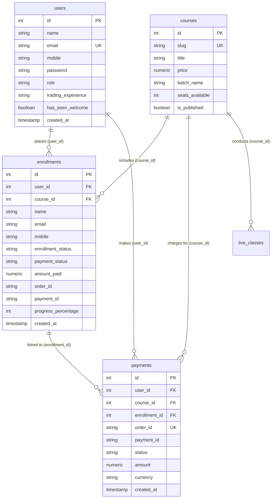

# TRADEMAX — Read-Only Authentication & Student Flow Audit Report

**Audit Mode**: Read-Only Inspection & Runtime Verification  
**Date**: October 17, 2026  
**Auditor**: Antigravity AI Engineering Team  
**Scope**: Registration, Login, Session Management, Routing, Dashboard Protection, Logout, and Course Enrollment  

---

## Executive Summary

This audit investigates the end-to-end authentication and student journey within TRADEMAX to determine why a student might see the public homepage instead of the Student Dashboard after logging in or registering.

### Key Finding: Why Students See the Homepage After Logging In

Our inspection identified **four distinct root causes** that lead to students seeing the homepage instead of the Student Dashboard:

1. **The `pendingCourseEnrollRef` Trap in `App.jsx`**:
   When an unauthenticated visitor clicks "Register" or "Enroll" from the homepage or Course Details page, `handleRegisterForCourse` sets `pendingCourseEnrollRef.current = true` before opening the login modal. When the user successfully signs in, `handleLoginSuccess` detects this flag and opens the course enrollment modal, but **returns immediately without calling `setCurrentView('dashboard')` or setting `window.location.hash = '#dashboard'`**. If the user closes the modal or dismisses checkout, they remain on the public homepage.

2. **Hash-Routing Override on `#home` and Empty Hash `""`**:
   In `App.jsx`, `handleLocationSync()` listens to browser `hashchange` and `popstate` events. Lines 310–313 contain:
   ```javascript
   if (hash === '#home' || hash === '') {
     setCurrentView('landing');
     return;
   }
   ```
   If an authenticated student visits `http://localhost:5173/`, clicks the TRADEMAX brand logo (`href="/"`) or navigates to `#home`, the router **blindly forces `landing` (the homepage)** without checking if the user is already authenticated.

3. **Page Refresh / Mount Verification Ignores Logged-in Users on `#home`**:
   During initial mount (`useEffect` in `App.jsx`), session verification calls `authService.getMe()`. However, the conditional check explicitly excludes `#home` and `#courses`:
   ```javascript
   if (hash !== '#home' && hash !== '#courses' && (hash === '#dashboard' || hash === ''))
   ```
   If a student is on the homepage URL (`#home`) and refreshes, they remain on the public homepage instead of being routed to their dashboard.

4. **Desktop Navigation Bar Lacks a "Student Dashboard" Link**:
   When logged in on desktop, the navbar changes the right-side actions to:
   ```jsx
   <div className="tm-nav-user-badge">
     <span>{user.name}</span>
     <button onClick={onLogout}>Logout</button>
   </div>
   ```
   The user badge is a static container, not a link or button. The desktop navigation menu only lists `Home`, `Courses`, `Founder`, `Gallery`, and `Trading Terminal` (which opens the stock chart widget, not the student learning portal). An authenticated student viewing the homepage has **no clickable navigation link to return to their dashboard** on desktop.

5. **Critical Runtime Bug in `AuthOverlay.jsx` (High Severity)**:
   In `src/components/landing/AuthOverlay.jsx` (lines 62–63), `openFrom` calls `setIsSuccess(false)` and `setSuccessData(null)`. However, `isSuccess` and `successData` state hooks were removed during the recent popup removal. Calling `openFrom` now triggers an uncaught `ReferenceError: setIsSuccess is not defined`, crashing the auth overlay on button click unless fixed.

---

## A. Current Application Architecture

- **Frontend**: React 18 SPA bundled with Vite 8.
- **Client Routing**: Custom state-based router controlled by `currentView` in `App.jsx`, synchronized with URL hashes (`#home`, `#dashboard`, `#admin`, `#stocks`, `#settings`) and explicit paths (`/courses/trading-masterclass`, `/founder`, `/gallery`).
- **Backend**: Node.js & Express REST API (`http://localhost:5001`), proxied via Vite at `/api`.
- **Database**: PostgreSQL (`trademax_db`) with `pg` connection pool.
- **Authentication**: Dual-layer authentication:
  - **HTTP Layer**: Signed JSON Web Token (JWT) issued in an `HttpOnly`, `SameSite: Lax` cookie (`token`) valid for 7 days.
  - **Client Storage**: Duplicate JWT token saved to `localStorage.getItem('tm_token')` and serialized user profile saved to `localStorage.getItem('tm_student_session')`.
- **Authorization & RBAC**: Roles are `'student'` (default) and `'admin'`. Server-side validation via `authMiddleware` verifying JWT signatures using `JWT_SECRET`.

---

## B. Existing Student Signup Flow (Step-by-Step)

| Step | Action / Event | Relevant Code / File | Status |
| :--- | :--- | :--- | :--- |
| **1** | Visitor clicks "Register" or "Get Started" in Navbar or Hero | `Navbar.jsx:214`, `Hero.jsx:136` | **ISSUE FOUND**: Calls `authRef.current.openFrom(btn, 'register')`. Crashes with `ReferenceError: setIsSuccess is not defined` at `AuthOverlay.jsx:62`. |
| **2** | Modal opens (if bug bypassed) | `AuthOverlay.jsx:56-116` | **WORKING**: Expands smoothly and displays registration form. |
| **3** | Form data collected | `AuthOverlay.jsx:12-18` | **WORKING**: Collects `name`, `mobile`, `email`, `reference`, `password`. |
| **4** | Client validation | `AuthOverlay.jsx:174-186` | **WORKING**: Validates full name, email format (`\S+@\S+\.\S+`), password (>= 6 chars), reference dropdown. |
| **5** | API request dispatched | `authService.register` in `src/services/auth.js:12-46` | **WORKING**: `POST /api/auth/register` with credentials included. |
| **6** | Backend duplicate check | `backend/src/routes/auth.js:59-70` | **WORKING**: `SELECT id FROM users WHERE LOWER(email) = $1 LIMIT 1`. Returns `409 Conflict` if email already exists. |
| **7** | Password hashing | `backend/src/routes/auth.js:72-74` | **WORKING**: Salt rounds 10 using `bcrypt.hash(password, 10)`. Plaintext password is never saved. |
| **8** | Database insertion | `backend/src/routes/auth.js:77-97` | **WORKING**: Inserts into `users` table with `role = 'student'`, `status = 'active'`, `has_seen_welcome = false`. |
| **9** | JWT creation & Cookie delivery | `backend/src/routes/auth.js:101-110` | **WORKING**: Creates 7-day JWT signed with `JWT_SECRET`, sets `res.cookie('token', token, { httpOnly: true, sameSite: 'lax' })`. |
| **10** | Client storage update | `src/services/auth.js:38-44` | **WORKING**: Stores `tm_token` and `tm_student_session` in `localStorage`. |
| **11** | Post-registration redirect | `App.jsx:387-398` (`handleRegisterSuccess`) | **ISSUE FOUND**: If triggered via course CTA, trapped by `pendingCourseEnrollRef`, keeping student on the homepage. |

---

## C. Existing Student Login Flow (Step-by-Step)

| Step | Action / Event | Relevant Code / File | Status |
| :--- | :--- | :--- | :--- |
| **1** | User clicks "Login" in Navbar or Drawer | `Navbar.jsx:206`, `Navbar.jsx:430` | **ISSUE FOUND**: Calls `authRef.current.openFrom(btn, 'login')`. Throws runtime reference error `setIsSuccess`. |
| **2** | Login modal opens | `AuthOverlay.jsx` | **WORKING**: Switches to login tab with Email/Mobile and Password fields. |
| **3** | Form submission | `AuthOverlay.jsx:196-210` | **WORKING**: Sends credentials to `authService.login`. |
| **4** | Backend authentication | `backend/src/routes/auth.js:129-195` | **WORKING**: Queries `users` by `LOWER(email) = $1 OR mobile = $2`. Validates password with `bcrypt.compare`. Strips password hash. |
| **5** | Session persistence | `backend/src/routes/auth.js:172-181` | **WORKING**: Sets HttpOnly `token` cookie and sends JSON response with user object. |
| **6** | Client token storage | `src/services/auth.js:70-76` | **WORKING**: Sets `tm_token` and `tm_student_session` in `localStorage`. |
| **7** | Callback execution | `App.jsx:356-372` (`handleLoginSuccess`) | **ISSUE FOUND**: If `pendingCourseEnrollRef` was set, early-returns without switching view to `dashboard`. |
| **8** | Page redirect & URL hash sync | `App.jsx:368-370` | **ISSUE FOUND**: Sets `window.location.hash = '#dashboard'`. Triggers `hashchange`, but if subsequently navigating to `/` or `#home`, router forces student back to homepage. |

---

## D. Existing Dashboard Access & Redirect Logic

### Route Identification
- The Student Dashboard is rendered conditionally in `src/App.jsx` when `currentView === 'dashboard'`:
  ```jsx
  currentView === 'dashboard' ? (
    <StudentDashboard
      user={user}
      course={primaryCourse}
      onOpenCourseDetails={() => handleNavigate('course-details')}
      onRegisterCourse={handleRegisterForCourse}
      onExit={() => handleNavigate('landing')}
      onLogout={handleLogout}
      theme={theme}
      onToggleTheme={toggleTheme}
    />
  ) : ...
  ```

### Authentication Protection
1. **Frontend Route Guard** (`App.jsx:296-308`):
   ```javascript
   if (hash === '#dashboard') {
     if (!currentUser) {
       setCurrentView('landing');
       window.location.hash = '#home';
       if (authRef.current) {
         authRef.current.openFrom(null, 'login');
       }
       return;
     }
     setCurrentView('dashboard');
     window.scrollTo({ top: 0, left: 0, behavior: 'instant' });
     return;
   }
   ```
   Unauthenticated visitors attempting to access `#dashboard` are rejected, redirected to `#home`, and prompted with the login overlay.

2. **Backend API Protection** (`backend/src/routes/student.js:8`):
   All student portal endpoints (`/api/student/dashboard`, `/api/student/courses`, `/api/student/live-classes`, `/api/student/announcements`) are protected by `studentRouter.use(authMiddleware)`. Unauthenticated requests receive HTTP `401 Unauthorized`. Verified via runtime test:
   ```
   GET http://localhost:5001/api/student/dashboard -> 401 Unauthorized
   ```

3. **Data Retrieval in Dashboard**:
   `StudentDashboard.jsx:88-120` fetches student metrics using `fetch('/api/student/dashboard', { credentials: 'include' })`. The backend query retrieves:
   - User profile from `users` table (`id`, `name`, `email`, `mobile`, `reference`, `trading_experience`, `role`).
   - Active enrollments from `enrollments` table joined with `courses`.
   - Upcoming live classes from `live_classes` table.
   - Published announcements from `announcements` table.

4. **Weakness in Dashboard Fetch**:
   `StudentDashboard.jsx` does not include the `Authorization: Bearer <token>` header in its `fetch` calls, relying 100% on the `token` cookie. While this works in proxy setups, if third-party cookie restrictions or cross-origin scenarios occur, the request fails even if `localStorage` has a valid token.

---

## E. Existing Logout Flow (Step-by-Step)

| Step | Action / Event | Relevant Code / File | Status |
| :--- | :--- | :--- | :--- |
| **1** | Student clicks "Logout" in Desktop Navbar or Mobile Drawer | `Navbar.jsx:195`, `Navbar.jsx:415` | **WORKING**: Invokes `handleLogout` passed from `App.jsx`. |
| **2** | API logout request | `src/services/auth.js:122-133` | **WORKING**: Sends `POST /api/auth/logout`. |
| **3** | Server cookie invalidation | `backend/src/routes/auth.js:442-448` | **WORKING**: `res.clearCookie('token')`. |
| **4** | Local storage clearance | `src/services/auth.js:131-132` | **WORKING**: Clears `tm_token` and `tm_student_session`. |
| **5** | React state reset | `App.jsx:402-405` | **WORKING**: `setUser(null)`, `setCurrentView('landing')`, `window.location.hash = '#home'`. |
| **6** | Access verification | `App.jsx:296-304` | **WORKING**: Attempting to navigate back to `#dashboard` redirects to `#home` and opens login. |

---

## F. Existing Course Enrollment and Payment Flow

| Question / Requirement | Code Finding | Status |
| :--- | :--- | :--- |
| **Are account registration and course enrollment separate?** | **YES**. Account registration creates a record in `users`. Course enrollment creates a record in `enrollments`. A student can register an account without enrolling in a course, and vice versa. | **WORKING AS DESIGNED** |
| **Does clicking ENROLL NOW require authentication?** | **PARTIALLY**. If clicked on the homepage (`handleRegisterForCourse`), it checks `user`. If not logged in, it sets `pendingCourseEnrollRef.current = true` and opens login. However, if an unauthenticated user opens `CourseRegistrationModal` directly, they can enter their name, email, and phone and proceed to payment without pre-existing account credentials. | **INCONSISTENT** |
| **Is the selected course preserved after authentication?** | **YES**. The primary course is resolved via state (`primaryCourse`, slug `trading-masterclass`). | **WORKING** |
| **Does course enrollment create another student record?** | **NO**. In `backend/src/routes/payments.js:386-396`, the payment verification resolves `user_id` from token or looks up `SELECT id FROM users WHERE LOWER(email) = $1`. If no user exists, it sets `user_id = NULL` in `enrollments`. It does NOT duplicate the user in `users`. | **WORKING AS DESIGNED** |
| **How are existing student details populated during checkout?** | In `CourseRegistrationModal.jsx:29-40`, when `user` prop is present, `formData` is initialized and prefilled with `user.name`, `user.email`, `user.mobile`, and `user.trading_experience`. | **WORKING** |
| **How does Razorpay payment verification control course access?** | In `backend/src/routes/payments.js:254-490`, access is granted only after server-side cryptographic HMAC-SHA256 signature verification (`crypto.createHmac('sha256', secret).update(order_id + '|' + payment_id)`). Upon valid signature, `enrollment_status = 'enrolled'` and `payment_status = 'completed'` are committed in an atomic database transaction. | **VERIFIED & WORKING** |

---

## G. API Endpoints Involved

| Method | Endpoint | Protection | Controller / File | Description |
| :--- | :--- | :--- | :--- | :--- |
| `POST` | `/api/auth/register` | Public | `backend/src/routes/auth.js:30` | Creates student account, hashes password, sets cookie & returns token. |
| `POST` | `/api/auth/login` | Public | `backend/src/routes/auth.js:129` | Validates credentials, sets cookie & returns JWT token. |
| `GET` | `/api/auth/me` | Public / Token | `backend/src/routes/auth.js:200` | Verifies active session token and returns sanitized user record. |
| `POST` | `/api/auth/logout` | Public | `backend/src/routes/auth.js:442` | Clears `token` cookie. |
| `POST` | `/api/auth/mark-welcome-seen` | Protected | `backend/src/routes/auth.js:261` | Updates `has_seen_welcome = TRUE` in database. |
| `PUT` | `/api/auth/profile` | Protected | `backend/src/routes/auth.js:286` | Updates student profile information. |
| `POST` | `/api/auth/change-password` | Protected | `backend/src/routes/auth.js:324` | Updates student password after verifying current password. |
| `GET` | `/api/student/dashboard` | Protected | `backend/src/routes/student.js:14` | Returns aggregated metrics, profile, enrolled courses, announcements. |
| `GET` | `/api/student/courses` | Protected | `backend/src/routes/student.js:118` | Returns enrolled courses list for the authenticated student. |
| `GET` | `/api/student/live-classes` | Protected | `backend/src/routes/student.js:181` | Returns upcoming live mentoring sessions. |
| `GET` | `/api/student/announcements` | Protected | `backend/src/routes/student.js:209` | Returns published institutional announcements. |
| `GET` | `/api/payments/config` | Public | `backend/src/routes/payments.js:47` | Confirms Razorpay test mode key configuration. |
| `POST` | `/api/payments/create-order` | Public / Optional Token | `backend/src/routes/payments.js:67` | Generates secure Razorpay order from course database price. |
| `POST` | `/api/payments/verify` | Public / Optional Token | `backend/src/routes/payments.js:254` | Verifies HMAC signature and commits enrollment transaction. |
| `POST` | `/api/payments/failed` | Public | `backend/src/routes/payments.js:675` | Logs payment failures and drop-offs. |

---

## H. Relevant Frontend and Backend Files

| Component / Layer | File Path | Primary Responsibility |
| :--- | :--- | :--- |
| **Main Application** | `src/App.jsx` | Top-level view routing (`currentView`), session verification, hash synchronization, modal coordination. |
| **Authentication Modal** | `src/components/landing/AuthOverlay.jsx` | Fullscreen modal for login and registration form inputs and submission. |
| **Authentication Service**| `src/services/auth.js` | Frontend API client for register, login, session caching, and logout. |
| **Desktop / Mobile Nav** | `src/components/landing/Navbar.jsx` | Header branding, navigation links, login/logout buttons, mobile drawer. |
| **Student Dashboard** | `src/components/dashboard/StudentDashboard.jsx` | Student learning portal, courses, live classes, announcements, profile settings. |
| **Course Enrollment** | `src/components/courses/CourseRegistrationModal.jsx` | Razorpay checkout initiation, prefilled student details, transaction receipt. |
| **Backend Server** | `backend/src/server.js` | Express app configuration, CORS, cookie parser, route mounting. |
| **Auth Middleware** | `backend/src/middleware/auth.js` | JWT verification middleware extracting user from header or cookie. |
| **Auth Routes** | `backend/src/routes/auth.js` | Endpoints for register, login, session check, profile, logout. |
| **Student Routes** | `backend/src/routes/student.js` | Protected endpoints serving student portal metrics and data. |
| **Payments Routes** | `backend/src/routes/payments.js` | Razorpay order creation, cryptographic verification, enrollment commitment. |
| **Database Connection** | `backend/src/db.js` | PostgreSQL pool and table schema definitions. |

---

## I. Database Tables and Relationships Involved



---

## J. Bugs, Risks, and Inconsistencies Discovered

### 1. [CRITICAL BUG] ReferenceError in `AuthOverlay.jsx`
- **File**: [`src/components/landing/AuthOverlay.jsx`](file:///Users/ahsanimamkhan/Desktop/trademax/src/components/landing/AuthOverlay.jsx#L62-L63)
- **Lines**: 62–63
- **Current Behavior**:
  ```javascript
  setIsSuccess(false);
  setSuccessData(null);
  ```
  Neither `setIsSuccess` nor `setSuccessData` is declared as a state hook in `AuthOverlay.jsx`.
- **Impact**: Any user clicking "Login" or "Register" triggers `openFrom`, throwing `ReferenceError: setIsSuccess is not defined` and blocking the modal from opening.
- **Expected Behavior**: Lines 62–63 should be removed completely.

### 2. [HIGH BUG] `pendingCourseEnrollRef` Prevents Dashboard Navigation on Login
- **File**: [`src/App.jsx`](file:///Users/ahsanimamkhan/Desktop/trademax/src/App.jsx#L358-L362)
- **Lines**: 358–362
- **Current Behavior**:
  ```javascript
  if (pendingCourseEnrollRef.current) {
    pendingCourseEnrollRef.current = false;
    setIsRegisterModalOpen(true);
    return; // <--- Does NOT set currentView('dashboard')
  }
  ```
- **Impact**: When an unauthenticated visitor clicks "Register" or "Enroll Now" and is prompted to log in first, upon successful login they are kept on the homepage with `currentView = 'landing'`.
- **Expected Behavior**: If the student logs in, their view should transition to `dashboard` (or open the enrollment modal *on top* of the dashboard rather than staying on the homepage).

### 3. [HIGH BUG] Router Forces Authenticated Users to Homepage on `#home` or `""`
- **File**: [`src/App.jsx`](file:///Users/ahsanimamkhan/Desktop/trademax/src/App.jsx#L310-L313)
- **Lines**: 310–313
- **Current Behavior**:
  ```javascript
  if (hash === '#home' || hash === '') {
    setCurrentView('landing');
    return;
  }
  ```
- **Impact**: If a student is logged in and navigates to the root URL `/` (e.g. by clicking the TRADEMAX brand logo) or clicks "Home", the application resets their view to the public landing page.
- **Expected Behavior**: If the student is authenticated, navigating to root or clicking the logo should route them to their Student Dashboard, or provide clear navigation between the public landing page and their active dashboard.

### 4. [MEDIUM BUG] Missing Route for `/student` in Course Modal Success Screen
- **File**: [`src/components/courses/CourseRegistrationModal.jsx`](file:///Users/ahsanimamkhan/Desktop/trademax/src/components/courses/CourseRegistrationModal.jsx#L321)
- **Line**: 321
- **Current Behavior**:
  ```javascript
  onClick={() => { window.location.href = '/student'; }}
  ```
- **Impact**: Clicking "Go to Student Portal" in the payment confirmation screen navigates to `/student`. However, `App.jsx` only handles `#dashboard` or `#admin`. Navigating to `/student` causes a 404 or falls back to an unmanaged route.
- **Expected Behavior**: Should navigate to `#dashboard` via `onNavigate('dashboard')` or `window.location.hash = '#dashboard'`.

### 5. [MEDIUM RISK] No "Dashboard" CTA on Desktop Header for Logged-In Students
- **File**: [`src/components/landing/Navbar.jsx`](file:///Users/ahsanimamkhan/Desktop/trademax/src/components/landing/Navbar.jsx#L188-L200)
- **Lines**: 188–200
- **Current Behavior**: Displays `[Student Name] [Logout]`. No button or link to open the Student Dashboard.
- **Expected Behavior**: The user badge or navigation menu should include a direct "Student Dashboard" button so students can navigate freely between the landing page and the portal.

### 6. [LOW RISK] `StudentDashboard.jsx` Omits Bearer Token in Fetch Headers
- **File**: [`src/components/dashboard/StudentDashboard.jsx`](file:///Users/ahsanimamkhan/Desktop/trademax/src/components/dashboard/StudentDashboard.jsx#L92-L96)
- **Current Behavior**: Relies entirely on `{ credentials: 'include' }` without checking `localStorage.getItem('tm_token')`.
- **Expected Behavior**: Include `Authorization: Bearer <token>` in headers as fallback for environments blocking cross-site cookies.

---

## K. Missing Information and Tests Required

1. **Browser Interactive Flow Test**:
   - Because of the runtime `setIsSuccess` bug in `AuthOverlay.jsx`, an interactive end-to-end browser click test could not complete until this syntax error is fixed.
2. **Multi-Tab Sync Verification**:
   - When logging in from one tab, verify whether other tabs detect the session change via `storage` events.
3. **Password Reset Runtime Flow**:
   - Verify that `/api/auth/reset-password` updates the password and that the student can immediately authenticate with the new credentials.

---

## L. Recommended Corrections (Priority Order)

1. **Priority 1 (Immediate Fix)**:
   Remove lines 62–63 (`setIsSuccess(false); setSuccessData(null);`) from [`src/components/landing/AuthOverlay.jsx`](file:///Users/ahsanimamkhan/Desktop/trademax/src/components/landing/AuthOverlay.jsx) to eliminate the runtime crash when opening Login/Register modals.

2. **Priority 2 (Core Flow Correction)**:
   In [`src/App.jsx`](file:///Users/ahsanimamkhan/Desktop/trademax/src/App.jsx#L358-L370), update `handleLoginSuccess` and `handleRegisterSuccess` so that even if `pendingCourseEnrollRef` is active, the app switches view to `dashboard` and synchronizes `window.location.hash = '#dashboard'` before opening the enrollment modal.

3. **Priority 3 (Routing & Root Path Resolution)**:
   In [`src/App.jsx`](file:///Users/ahsanimamkhan/Desktop/trademax/src/App.jsx#L310-L313), update `handleLocationSync` so that if `currentUser` exists and `hash === ''` or `hash === '#home'`, the student is directed to `dashboard` (or given a clear portal entry point) instead of silently downgrading to `landing`.

4. **Priority 4 (Navigation UX Enhancement)**:
   In [`src/components/landing/Navbar.jsx`](file:///Users/ahsanimamkhan/Desktop/trademax/src/components/landing/Navbar.jsx#L188-L200), convert `.tm-nav-user-badge` on desktop into a clickable link/button to "Student Dashboard", matching the mobile drawer behavior (`.tm-fs-portal-btn`).

5. **Priority 5 (Course Modal Destination Fix)**:
   In [`src/components/courses/CourseRegistrationModal.jsx`](file:///Users/ahsanimamkhan/Desktop/trademax/src/components/courses/CourseRegistrationModal.jsx#L321), replace `window.location.href = '/student'` with navigation to `#dashboard`.

---

## 8. Final Summary & Flow Comparison

### Current Implementation Flow (Based on Code)

```
New Student → Click Register 
            → [CRASH: ReferenceError: setIsSuccess is not defined]
            → (If bypassed) POST /api/auth/register → 201 Created
            → handleRegisterSuccess()
            → IF pendingCourseEnroll: stays on Homepage (landing view)
            → ELSE: Student Dashboard

Existing Student → Click Login
                 → [CRASH: ReferenceError: setIsSuccess is not defined]
                 → (If bypassed) POST /api/auth/login → 200 OK
                 → handleLoginSuccess()
                 → IF pendingCourseEnroll: stays on Homepage (landing view)
                 → ELSE: Student Dashboard

Authenticated Student on Homepage → Clicks Brand Logo or Refresh on #home
                                 → handleLocationSync() forces currentView('landing')
                                 → Stays on Homepage with no Desktop Dashboard button

Student → Logout → POST /api/auth/logout → Clears Token & LocalStorage → Public Homepage (#home)
```

---

### Intended Implementation Flow (Goal Architecture)

```
New Student → Register → Auto Login → Student Dashboard (#dashboard)
Existing Student → Login → Student Dashboard (#dashboard)
Student Dashboard → Select Course → Course Details → Enroll → Payment → Immediate Course Access in Dashboard
Student → Logout → Public Homepage (#home)
```

---

**Report File**: `TRADEMAX_AUTH_FLOW_AUDIT.md`  
*Awaiting user approval before applying any code fixes.*
